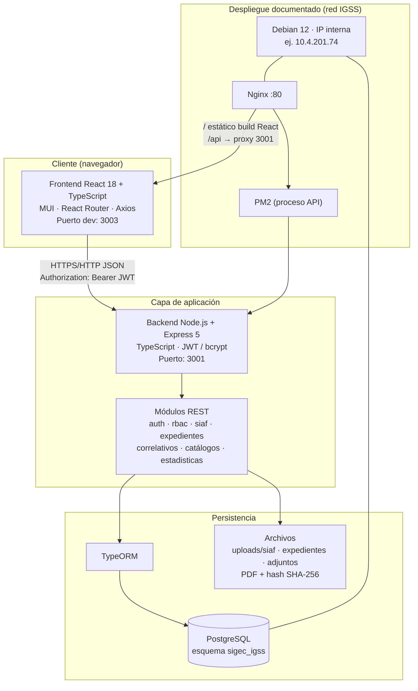
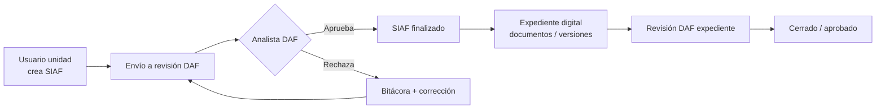

# Arquitectura SIGEC-IGSS

Sistema Integral de Gestión de Expedientes de Compras — IGSS (Consultorio Palín / DAF Escuintla).

## Vista de capas

## Flujo de negocio (resumen)

## Tecnologías por capa

| Capa | Tecnología |
|------|------------|
| Presentación | React 18, TypeScript, Material UI 5, Axios, Recharts |
| API | Node.js, Express 5, TypeScript, JWT, Multer, PDFKit |
| ORM / BD | TypeORM, PostgreSQL (`sigec_igss`) |
| Archivos | Sistema de archivos local (`backend/uploads`) |
| Local (demo) | Windows · `INICIAR-SIGEC.bat` · :3003 / :3001 / :5432 |
| Producción | Debian 12 · Nginx · PM2 · red privada IGSS |

## Nota para la demostración

Esta grabación corre en **entorno local**. El servidor institucional está en **red privada del IGSS**; desde fuera no hay acceso público. El código y la arquitectura son los mismos; cambia el host de despliegue.
